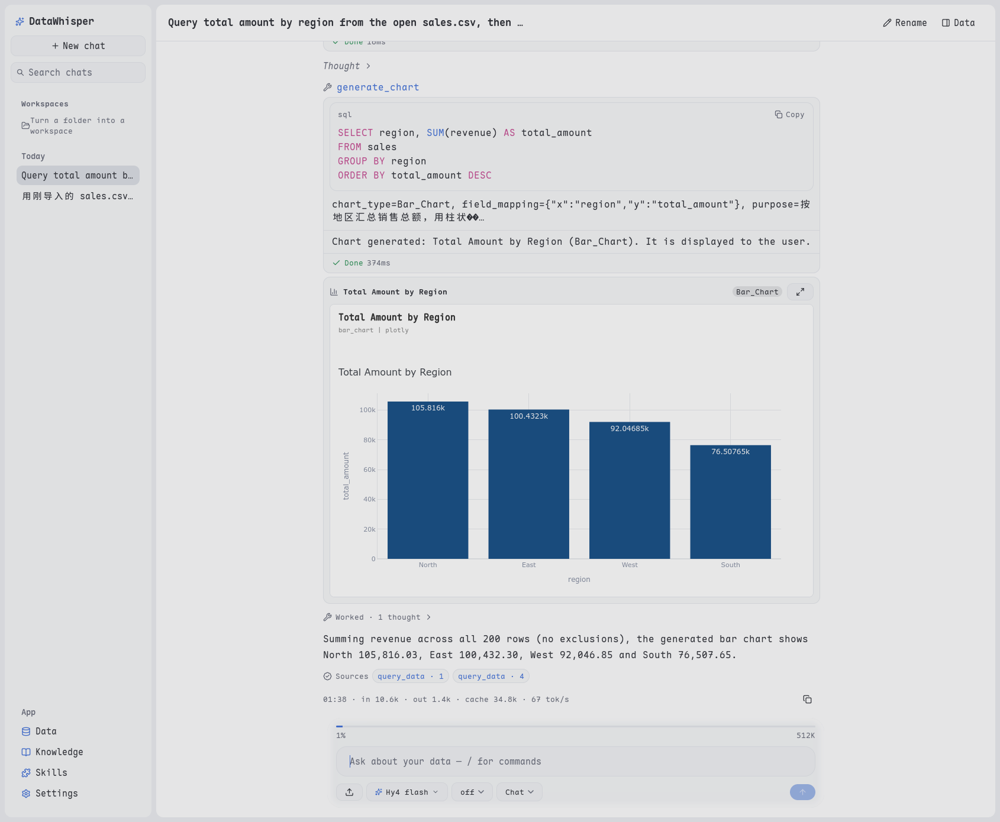
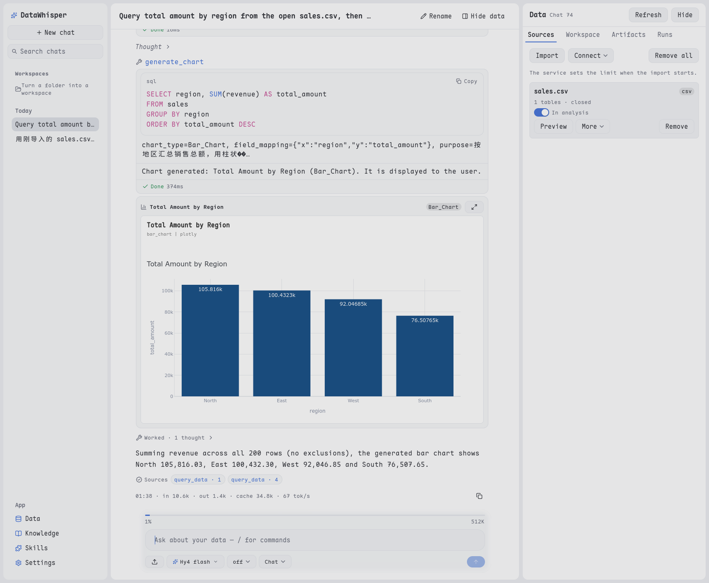
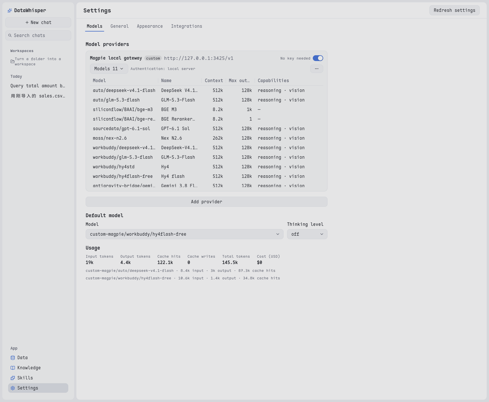
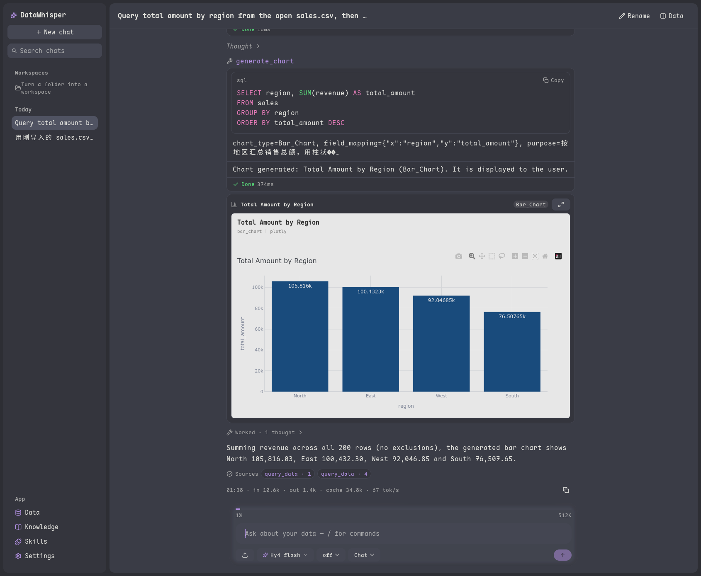

# DataWhisper

[简体中文](./README_CN.md)

A local, single-user desktop app for business data analysis. Ask in natural language; the agent queries your
data, draws the chart, and writes the conclusion down.

No account, no hosted model, no telemetry. You bring an OpenAI-compatible endpoint or a local gateway, and
everything — sessions, imported files, charts, credentials — stays on this machine.



## What you can do

- **Ask in natural language.** The agent picks tools, runs SQL over DuckDB, profiles columns, draws one of 41
  chart templates, and explains the result with numbers traceable back to tool output.
- **Bring your own data.** Drag CSVs/XLSX/PDF onto the composer, import from the data panel, mount a folder as
  a workspace, or connect SQL / Google Sheets / Feishu Bitable / HTTP sources.
- **Keep working across turns.** Long tasks, workflow runs, team delegations, approval cards, and MCP tool
  servers all show up in the same chat and the Runs tab.
- **Stay local.** The desktop app, the agent service, and the Python compute worker talk over pipes only — no
  ports, no HTTP server, no cloud storage.

## Screenshots

| | |
|---|---|
|  |  |
| Data panel: sources, tables, artifacts, runs | Settings: providers, models, context limits, usage |
|  | |

## How it works

| Piece | Technology | Role |
|---|---|---|
| Desktop app | Go + [MyGo](https://mygo.egoist.dev) native UI | Chat, data panel, settings, workspaces |
| Agent service | Bun + `@earendil-works/pi-durable` | Model turns, tools, permissions, durable tasks, workflows, MCP, Feishu bot |
| Compute worker | Python (pandas / DuckDB / Plotly) | Data loading, SQL, statistics, charts, exports |

```
desktop (Go/MyGo) ──stdio JSON-RPC 2.0──▶ server (Bun)
server ──stdio JSON-RPC 2.0──▶ compute (Python)
```

The desktop app spawns the service; the service spawns the compute worker. The service is the only state
holder (SQLite per data directory); compute is stateless and restarts cleanly. Charts are rendered in the app's
web view with the bundled Plotly / ECharts / D3 assets.

## Quick start (from source)

Requirements: Go 1.24+, Bun 1.4+, Python 3.11 with a virtualenv, and WebKitGTK 4.1 on Linux
(`webkit2gtk-4.1`).

```bash
python3 -m venv .venv
.venv/bin/pip install -r compute/requirements.txt
bun install --cwd server

cd desktop && go run .
```

First run: the home screen points you to **Settings → Models**. Pick a preset (local Ollama, any
OpenAI-compatible gateway, AtlasCloud) or add your own endpoint, paste the key if the endpoint needs one, then
**Discover models** to pull context limits instead of typing them by hand. New chats then use the default
model you choose.

Ask a question, or drop a CSV/XLSX/PDF onto the composer. The **Data** button opens the panel with sources,
workspace files, artifacts, and runs.

## Features

- **Chat** — streaming Markdown, collapsible thinking and tool calls, inline charts, slash commands,
  interrupt/queue, `ask_user` question cards, first-token latency while replying.
- **Data panel** — import files, connect remote sources, preview tables and schemas, choose which columns take
  part in analysis, mount a workspace folder, review runs and artifacts.
- **Analysis** — SQL over DuckDB, 41 chart templates, statistical templates, cleaning, Excel/report/PPT/
  dashboard exports, knowledge base (metrics, rules, notes) with local embeddings.
- **Trust** — numbers in the final answer are checked against tool results; long tool output spills to
  artifacts the model must re-read; write tools ask for confirmation; workspace chats run in a permission mode.
- **Integrations** — MCP servers (stdio/SSE) with per-turn discovery, Feishu bot (long connection or webhook),
  provider presets including local gateways.
- **Local by default** — one SQLite database per data directory, credentials in the OS keychain (or a `0600`
  file fallback), no telemetry, no accounts.

## Data locations

| Platform | Path |
|---|---|
| Linux | `~/.local/share/datawhisper` |
| macOS | `~/Library/Application Support/DataWhisper` |
| Windows | `%APPDATA%\DataWhisper` |

Set `DW_DATA_DIR` to override. The directory holds `datawhisper.sqlite` (sessions, tasks), `library.sqlite`
(titles, hooks, archived runs), `uploads/`, `outputs/` (charts, exports), and `tool_results/` (spilled tool
outputs).

## Building installers

```bash
scripts/build/build-app.sh              # Linux: deb + tar.gz + PKGBUILD under desktop/build/
```

Linux packaging is what the release workflow builds today; macOS/Windows packaging is not maintained. See
[`docs/refactor/packaging.md`](docs/refactor/packaging.md) for prerequisites, signing and update keys.

## Development

```bash
# agent service
cd server && bunx tsc --noEmit -p . && bun test

# desktop
cd desktop && gofmt -l . && go vet ./... && go test -race -count=1 ./...

# compute (repository-root .venv)
.venv/bin/python -m unittest compute.tests.test_rpc compute.tests.test_tools \
  compute.tests.test_ui_methods compute.tests.test_chart_templates compute.tests.test_chart_snapshots
```

CI runs the same three suites. Design notes live in [`docs/refactor/`](docs/refactor/):
the pipe protocol, upload hand-off, tool exposure rules and the refactor evidence.

## Upgrading from the old web app

The previous version was a Flask web app with login, quotas and hosted models. That code is gone; existing
sessions, job records and workflow runs can be imported:

```bash
cd server && bun run scripts/migrate-old-data.ts --from <old repo> --to <data dir> --dry-run
```

Drop `--dry-run` once the report looks right. Old job and workflow records become read-only archives.

## Non-goals

- No web or cloud edition, no multi-user accounts, no telemetry.
- No browser automation: `browser_extract_tables` answers with an explicit “not available in this build” and
  points at `fetch_table` / file import instead.
- Model endpoints must be OpenAI-compatible; provider-specific SDKs are not embedded.

## License

See [LICENSE](LICENSE).
