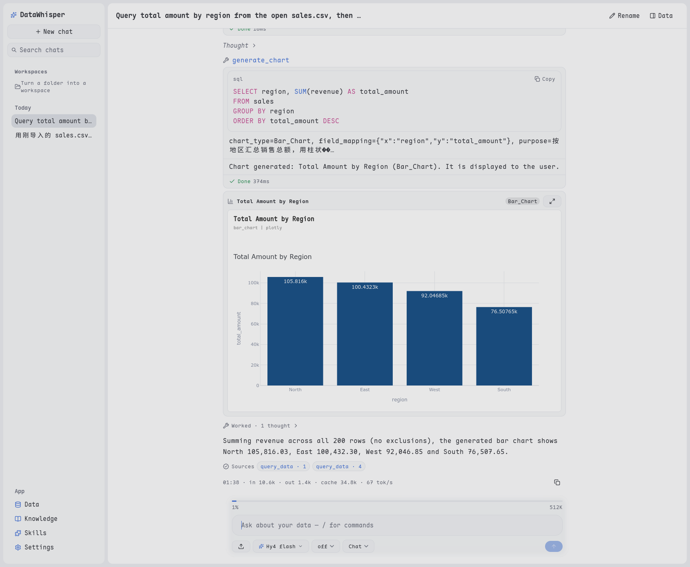
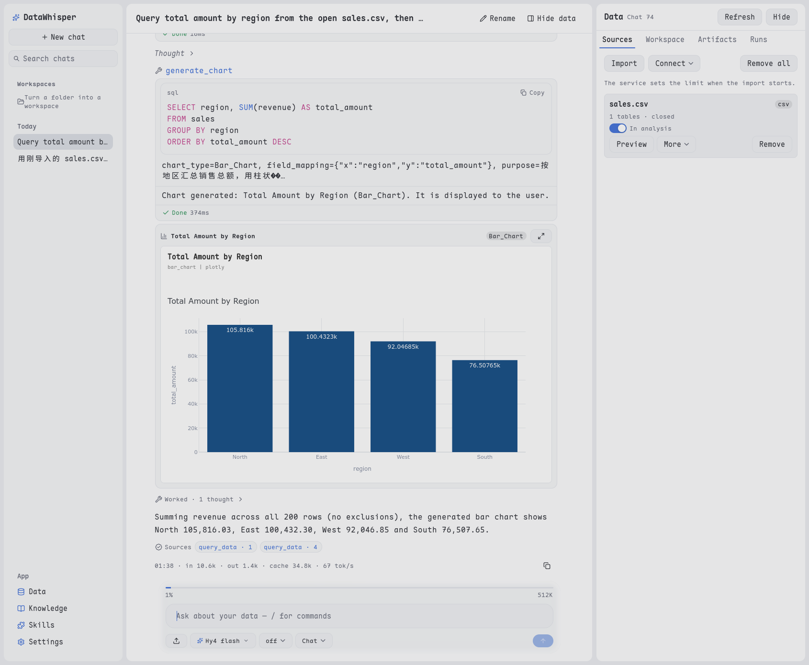
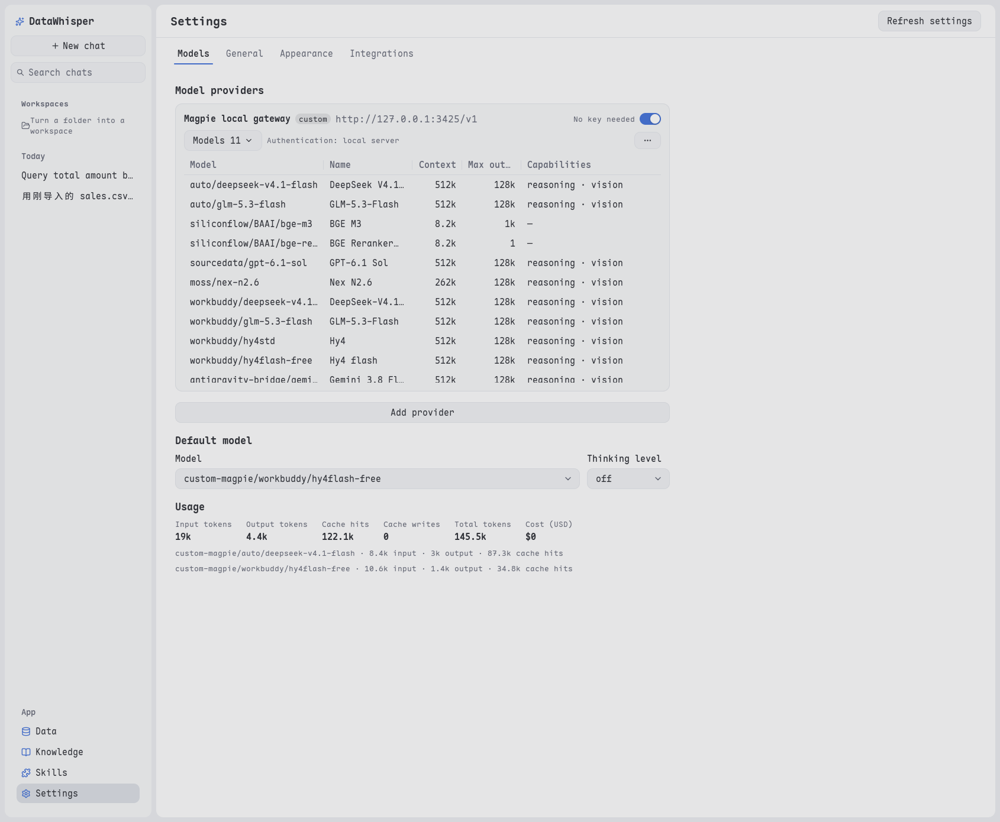
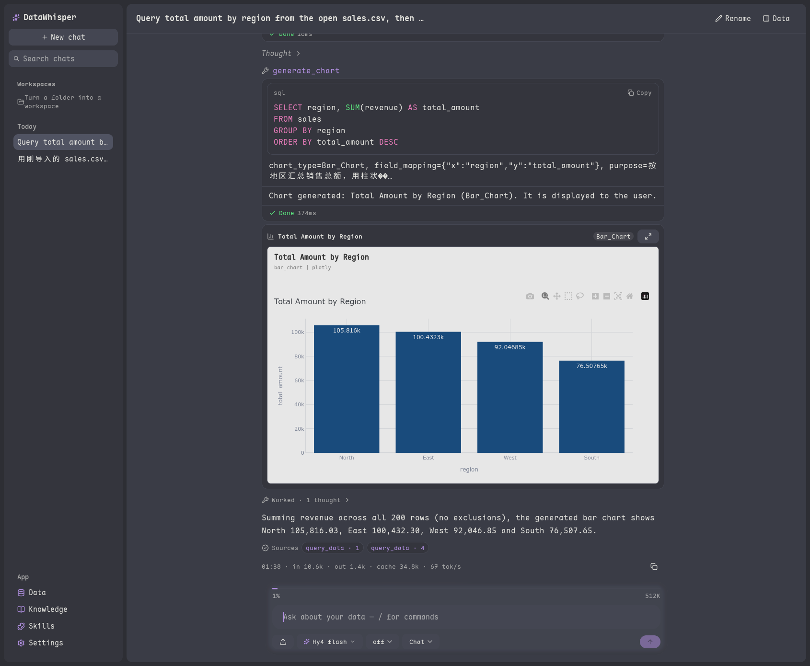

# DataWhisper

[English](./README.md)

本地单用户的桌面数据分析应用。用自然语言提问，agent 去查数据、画图，并把结论写下来。

不需要账号，不依赖托管模型，没有遥测。模型端点由你提供（任意 OpenAI 兼容地址或本地网关），会话、导入
的文件、图表与凭据都留在这台机器上。



## 能做什么

- **自然语言提问**。agent 自己挑工具：用 DuckDB 跑 SQL、做列画像、从 41 个图表模板里选一张，再用能追溯到
  工具结果里的数字写结论。
- **数据随你带**。把 CSV/XLSX/PDF 拖进输入区、从数据面板导入、挂载一个文件夹作为工作区，或连接 SQL /
  Google Sheets / 飞书多维表格 / HTTP 来源。
- **跨回合接着干**。长任务、工作流运行、团队委派、审批卡片与 MCP 工具服务器都出现在同一个对话和「运行」页签里。
- **保持本地**。桌面端、agent 服务与 Python 计算进程只通过管道通信——没有端口、没有 HTTP 服务、没有云存储。

## 截图

| | |
|---|---|
|  |  |
| 数据面板：来源、表、产物、运行 | 设置：提供方、模型、上下文上限、用量 |
|  | |

## 工作方式

| 组成 | 技术 | 职责 |
|---|---|---|
| 桌面端 | Go + [MyGo](https://mygo.egoist.dev) 原生 UI | 对话、数据面板、设置、工作区 |
| agent 服务 | Bun + `@earendil-works/pi-durable` | 模型回合、工具、权限、长任务、工作流、MCP、飞书机器人 |
| 计算进程 | Python（pandas / DuckDB / Plotly） | 数据加载、SQL、统计、图表、导出 |

```
desktop (Go/MyGo) ──stdio JSON-RPC 2.0──▶ server (Bun)
server ──stdio JSON-RPC 2.0──▶ compute (Python)
```

桌面端拉起服务，服务拉起计算进程。状态只在服务里（每个数据目录一个 SQLite）；计算进程无状态，重启即可。
图表在应用的 web view 里渲染，使用随包携带的 Plotly / ECharts / D3。

## 快速开始（源码运行）

需要 Go 1.24+、Bun 1.4+、Python 3.11（虚拟环境），Linux 上还需要 WebKitGTK 4.1（`webkit2gtk-4.1`）。

```bash
python3 -m venv .venv
.venv/bin/pip install -r compute/requirements.txt
bun install --cwd server

cd desktop && go run .
```

首次启动：首页会把你引到 **设置 → 模型**。选一个预设（本地 Ollama、任意 OpenAI 兼容网关、AtlasCloud），
或自己填端点；需要密钥的填上，再点 **发现模型** 从端点拉上下文上限。选好默认模型后，新对话就用它。

提问，或把 CSV/XLSX/PDF 拖进输入区。标题栏的 **数据** 按钮打开面板：来源、工作区文件、产物与运行。

## 功能

- **对话** —— 流式 Markdown、可折叠的思考与工具调用、内嵌图表、斜杠命令、打断/排队、`ask_user` 问题卡片，
  回复中显示首字延迟。
- **数据面板** —— 导入文件、连接远程来源、预览表与结构、选择参与分析的列、挂载工作区文件夹、查看运行与产物。
- **分析** —— DuckDB 上的 SQL、41 种图表模板、统计模板、清洗、Excel/报告/PPT/仪表盘导出、知识库
  （指标、规则、笔记）与本地向量检索。
- **可信** —— 最终回答里的数字要对上工具结果；过长的工具输出外溢成产物，模型必须显式再读；写操作要确认；
  工作区对话跑在权限模式下。
- **集成** —— MCP 服务器（stdio/SSE，按回合发现工具）、飞书机器人（长连接或 webhook）、含本地网关的提供方预设。
- **本地优先** —— 每个数据目录一个 SQLite；凭据在系统钥匙串（没有时退化为 `0600` 文件）；无遥测、无账号。

## 数据位置

| 平台 | 路径 |
|---|---|
| Linux | `~/.local/share/datawhisper` |
| macOS | `~/Library/Application Support/DataWhisper` |
| Windows | `%APPDATA%\DataWhisper` |

可用 `DW_DATA_DIR` 覆盖。目录里有 `datawhisper.sqlite`（会话、任务）、`library.sqlite`（标题、hooks、归档运行）、
`uploads/`、`outputs/`（图表、导出）与 `tool_results/`（外溢的工具输出）。

## 打包

```bash
scripts/build/build-app.sh              # Linux：deb + tar.gz + PKGBUILD，输出到 desktop/build/
```

发布流程目前只打 Linux 包；macOS/Windows 打包不维护。细节见
[`docs/refactor/packaging.md`](docs/refactor/packaging.md)。

## 开发

```bash
# agent 服务
cd server && bunx tsc --noEmit -p . && bun test

# 桌面端
cd desktop && gofmt -l . && go vet ./... && go test -race -count=1 ./...

# 计算进程（仓库根 .venv）
.venv/bin/python -m unittest compute.tests.test_rpc compute.tests.test_tools \
  compute.tests.test_ui_methods compute.tests.test_chart_templates compute.tests.test_chart_snapshots
```

CI 跑同样三套。设计笔记在 [`docs/refactor/`](docs/refactor/)：管道协议、上传交接、工具暴露规则与重构证据。

## 从旧版网页应用升级

旧版是带登录、配额与托管模型的 Flask 网页应用，代码已删除；已有会话、任务与工作流记录可以导入：

```bash
cd server && bun run scripts/migrate-old-data.ts --from <旧仓库> --to <数据目录> --dry-run
```

报告确认后去掉 `--dry-run`。旧任务与工作流记录会变成只读归档。

## 非目标

- 不做网页版/云端版、多用户账号与遥测。
- 不做浏览器自动化：`browser_extract_tables` 明确回答「这一版没有浏览器自动化」，并给出 `fetch_table`
  或上传文件的替代路径。
- 模型端点必须是 OpenAI 兼容接口，不内嵌各家专用 SDK。

## 许可

见 [LICENSE](LICENSE)。
