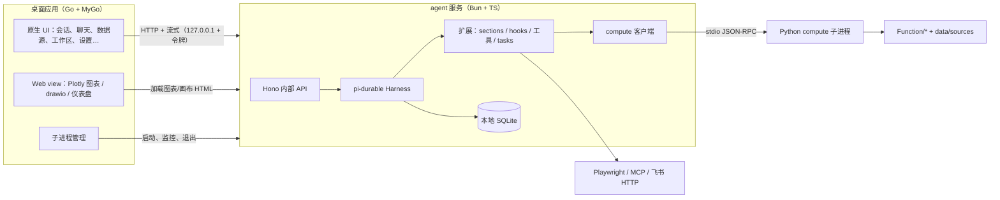

# 基于 pi-durable 的全量重构：任务说明与拆分

状态：已确认，按 P0 开始实施
分支：`refactor/pi-durable`（从 `main@87489fb` 切出；`main` 不做任何改动）

## 1. 目标

产品定位：**用户在本机自用的数据分析桌面工具**，使用体验类似 ChatGPT 桌面版：打开就能用，以对话为中心，会话列表、流式回复、图表和文件结果都在一个窗口里。不登录，不提供模型服务；模型提供商（OpenAI、Anthropic、DeepSeek、Ollama 本地模型、任意 OpenAI 兼容地址等）、模型和 API key 都由用户在设置里自己配置，对话中可以切换模型。

技术组成：

- 界面：Go + MyGo 原生 UI（`github.com/egoist/mygo/ui`），替代现有的 HTML/JS 前端。
- agent 与业务服务：TypeScript，运行在 Bun 上，agent 核心使用 `@earendil-works/pi-durable`。
- 计算：Python 只保留直接处理 DataFrame 的代码，作为子进程运行。

不再做 Web 端和云端部署。

重构后应满足：

- 现有的本地功能不减少：72 个工具、30 个 skills、17 个斜杠命令、工作流、teams、知识库、导出、数据源、仪表盘、画布、飞书机器人长连接。不再提供模型服务：模型和 API key 由用户自己配置。
- agent 运行可持久化：应用崩溃或重启后，未完成的对话、工具调用和长任务能接着跑。
- 会话持久化到本地 SQLite，不再只放在内存里。
- 一个安装包装好全部组件，支持 macOS、Windows、Linux。

## 2. 已确定的决策

| 事项 | 决定 |
|---|---|
| 交付形态 | 桌面应用；不做 Web 端 |
| 界面 | Go + MyGo 原生 UI，锁定 `github.com/egoist/mygo v0.7.4`；Plotly 图表、drawio 画布、仪表盘这类 HTML 内容用 MyGo 的 Web view 组件嵌入 |
| 界面协议 | 新协议：界面连接或重连时先拿到对话的当前状态，之后服务只推送增量；不兼容旧 SSE 事件 |
| 模型 | 不提供模型或 token 服务；用户自己配置提供商、模型和 API key |
| 云端功能 | 只保留飞书机器人长连接。删除登录与用户（含邮箱验证码、找回密码、`BAA_CLOUD_AUTH_URL` 云端转发、`desktop_token`）、管理后台、每日 token 配额、平台托管模型（`HOSTED_MODEL_SPECS`）、Docker/Railway/Vercel 部署 |
| 用户 | 单用户应用，不需要登录；数据属于本机当前系统用户 |
| agent 核心 | `@earendil-works/pi-durable`，锁定精确版本 `1.5.0`（同时锁 `pi-ai`、`chord` 1.5.0） |
| agent 运行时 | Bun（P0.3 已验证 pi-durable 1.5.0 在 Bun 1.4.4 上可用，见 `docs/refactor/p0.3-findings.md`） |
| 服务框架 | UI 与 agent 服务之间用**子进程的 stdin/stdout 上 JSONL 的 JSON-RPC 2.0**（无端口、无令牌、无网络面）；分帧与 compute 链路一致，理由见 `docs/refactor/ui-transport.md` |
| Python 范围 | 只保留 `Function/`（分析、清洗、图表、导出、知识库）和 `data/sources`，约 4.5 万行 |
| Python 通信 | stdio JSON-RPC 子进程，由 Bun 服务启动和管理 |
| 存储 | 本地一个 SQLite 库（单用户） |
| 历史数据 | 写一次性迁移脚本，导入 pi-durable 存储 |
| 推进方式 | 在本分支上按模块逐步替换，每个阶段都能运行和验证 |
| 上游 | 独立维护，不再合并 `Zafer-Liu/Data-Analysis-Agent` |
| 测试基线 | 在本分支写测试，对本地运行的旧 Flask 服务录制基线；不改 `main` |

## 3. 现状（迁移输入）

| 项 | 数据 | 来源 |
|---|---|---|
| Python 代码 | `Function/` 3.2 万行、`agent/` 2.7 万行、`data/` 1.4 万行、`api/` 1.3 万行、`infrastructure/` 0.4 万行 | 行数统计 |
| 前端（将被 Go 原生 UI 替代） | `frontend/` 2.7 万行 JS、`static/` 1.2 万行 CSS、`templates/` 4 个页面（`agent_chat.html` 100 KB） | 同上 |
| HTTP 路由 | 288 条（27 个蓝图 286 条 + app 级 2 条） | 路由盘点 |
| 流式事件 | 一次 POST 返回 SSE，约 28 种事件类型 | 事件契约盘点 |
| 工具 | 72 个：A 类（纯 TS）40、B 类（调 Python）14、C 类（特殊）18 | 工具盘点 |
| 测试 | 本 clone 没有 Python 单测（`.gitignore` 忽略 `/tests`），只有 `Function/Charts_generation/tests/` 4 个文件 | `.gitignore:183` |
| 工具链 | Go 1.27.3、Bun 1.4.4、Node 26、uv；Python 3.11.18 venv 已建（`.venv`） | 本机 |

盘点中发现的已有缺陷（迁移时一并处理，不照搬）：

1. `agent_delegate` 已注册、有 schema 和提示词，但没有执行分支，调用会出错。
2. 工具的 `confirmation` 只是元数据，运行时没有检查。
3. 前端 SSE 重试会重新 POST，服务端已开始时会重复执行一轮。
4. `done` 事件会发两次。

## 4. 目标架构

进程关系：Go 应用是主进程，启动 Bun 服务（发布时用 `bun build --compile` 编译成单文件）；Bun 服务启动 Python compute（发布时用 PyInstaller 打包）。任何一层退出或崩溃，由上一层负责重启；pi-durable 保证重启后对话和任务接着跑。

目录规划（新增，旧目录在 P10 删除）：

- `desktop/`：Go 模块，MyGo 原生 UI 与子进程管理
- `server/`：Bun/TS 服务（内部 API、Harness、扩展、工具、存储）
- `compute/`：Python 计算子进程（RPC 协议、数据源注册表、方法表）
- `Function/`、`data/sources/`：保留，不改动或只做最小适配
- `scripts/migrate/`：一次性数据迁移脚本

## 5. 任务拆分

每个任务都要写明产出和验收方式。阶段内的任务可以并行，阶段之间按依赖顺序推进。

### P0 基线与技术验证

| 任务 | 内容 | 验收 |
|---|---|---|
| P0.1 开发环境 | Python 3.11 venv（已建）；Bun 1.4；Go 1.27；`mygo doctor` 检查；Linux 上的 WebKitGTK 4.1 | `mygo doctor` 通过；`python -m compileall Function data` 通过 |
| P0.2 行为基线 | 对旧 Flask 服务录制**行为**基线：用固定小数据集和模型桩，记录 14 个 B 类计算工具的输出、agent 一轮对话的工具调用序列、每轮可见工具列表。不再录制 HTTP 路由形状（旧前端会被替换，路由不需要保持兼容） | 对本分支上尚未改动的旧服务全部通过；测试只依赖 HTTP，不 import Python 模块 |
| P0.3 技术验证原型 | 在 `server/spike/` 和 `desktop/spike/` 写最小原型，验证四件事：① pi-durable 在 Bun 上运行（SQLite 存储、自定义 OpenAI 兼容提供商）；② 工具执行中杀进程后 `resume()` 续跑、`requestId` 去重；③ 每轮动态调整工具集；④ MyGo 原生窗口流式显示 Markdown 回复，并在 Web view 中显示一张 Plotly 图表 | 原型可运行；写出验证结论；任何一项不成立时回到本文档调整方案 |

### P1 Python 计算进程

| 任务 | 内容 | 验收 |
|---|---|---|
| P1.1 RPC 协议 | 按行分隔的 JSON-RPC 2.0；stdout 只走协议、日志走 stderr；`progress`/`event` 通知；`$/cancel` 取消；`shutdown` | 协议单测：并发请求、取消、异常、非法输入 |
| P1.2 数据源与 B 类方法 | 按 `source_id` 维护已打开的数据源，同一数据源串行访问；把 `api/datasource.py` 的 `_restore_source` 移到 `compute/sources.py`；实现 14 个 B 类工具的计算方法 | 每个方法用 P0.2 的数据集跑通，输出与基线一致 |
| P1.3 界面侧计算 | 旧 API 中直接处理 DataFrame 的操作（上传解析、表预览、知识库入库、仪表盘数据、导出下载等）改为 RPC 方法 | P6 的内部 API 可直接调用 |
| P1.4 Bun compute 客户端 | 一个子进程；启动、健康检查、崩溃后重启并按描述重新打开数据源；取消；进度回调 | 杀掉子进程后下一次调用自动恢复；内存态分析表丢失时返回明确错误 |

说明：内存 DuckDB 中运行时创建的分析表在子进程重启后会丢失，持久化工作区的表不受影响。这与现在 Flask 进程重启的行为一致。

### P2 服务与桌面骨架

| 任务 | 内容 | 验收 |
|---|---|---|
| P2.1 Bun 服务工程 | TS 工程（ESM、strict）、配置加载、stdio JSONL RPC 传输、启动时打开 Harness 并 `resume()` | 分帧乱序/粘包/非法 JSON 有对应用例；重启后会话和未完成的运行都能恢复 |
| P2.2 桌面应用骨架 | `desktop/` Go 模块：主窗口、侧边栏导航、子进程管理（启动 Bun 服务、读取端口和令牌、退出时清理、崩溃重启）、Go 端 API 客户端 | 启动应用即可连上服务；手动杀掉 Bun 进程后界面提示并自动恢复 |
| P2.3 界面通信协议 | Go 界面与 Bun 服务之间的流式协议：订阅时先发 `snapshot`（`conversation.watch()` 的当前值：消息、进行中的回复、运行中的工具及输出、排队消息、用量），之后转发 `ops` 增量，带序号；断线后重新订阅即可。Web view 资源用 URL 参数里的令牌鉴权（P0.3 已验证） | 协议文档 + Go、TS 两端的类型定义；断线重连后界面状态与服务端一致 |

### P3 agent 核心

| 任务 | 内容 | 验收 |
|---|---|---|
| P3.1 模型 | 用户自配提供商：把 `LLM/llm_config_manager.py` 中的提供商（deepseek/openai/atlascloud/ollama/claude/minimax）转为 pi-ai 定义，Anthropic 等用 pi-ai 原生接口；支持用户添加任意 OpenAI 兼容地址和自定义模型（上下文长度、是否支持思考）；API key 用系统密钥存储；每个对话可单独切换模型和思考强度；删除 `HOSTED_MODEL_SPECS` 和配额倍率 | 每个提供商能完成一次流式对话（ollama 本地验证，其余用已配置的 key）；对话中途切换模型后下一轮生效 |
| P3.2 系统提示 | `agent/prompts.py`、skills 目录与加载优先级、memory、instructions、命令（`commands/*.md`）改为扩展的 sections 和命令 | 同一输入下系统提示与旧版逐段对比一致 |
| P3.3 hooks | 数字溯源核对（`number_audit.py`）、禁止输出类工具的策略、模型调用审计、文本形式工具调用解析、现有用户 hooks（`agent/hooks/*`） | 每条策略有触发用例 |
| P3.4 工具暴露 | 每轮最多 20 个工具、阶段过滤、关键词发现（3 轮 TTL）、skill 限制工具集、`read_tool_result` 可见性。实现方式按 P0.3 结论：一个会话文档记录发现的工具和限制，提交前和工具执行中根据它算出工具集并调用 `configure({ modelTools })`；不用 `beforeProviderRequest` 过滤（它不阻止调用未提供的工具） | 给定输入，工具列表与 P0.2 基线一致；调用未提供的工具被拒绝 |
| P3.5 chat 接口 | 新建对话、提交（带 `requestId`）、中止、插队引导、订阅对话状态；按 P2.3 的协议推送 | 用命令行客户端能完整完成一轮带工具调用的对话；重连后状态正确 |
| P3.6 压缩与计量 | 用 pi-durable 后台压缩替代 `compaction.py`；工作流阶段归档（`stage_compaction.py`）；prompt cache 策略（P0.3 发现请求体里没有 `prompt_cache_key`，要补上）；token 统计 | 长对话不中断；用量数字与提供商返回一致 |

### P4 工具迁移

| 任务 | 内容 | 验收 |
|---|---|---|
| P4.1 A 类 40 个 | 工作区文件、任务、teams 存储、图表选择、提案类输出、ask_user、diagram、memory、飞书读取、网页抓取等，直接用 TS 实现 | 每个工具有用例；`replay` 策略按盘点表设置 |
| P4.2 B 类 14 个 | TS 工具外壳调用 P1 的 RPC 方法；进度通过工具输出流转发；长任务的幂等键用 `taskId` | 结果和基线一致；中途杀进程后按 `replay` 规则正确处理 |
| P4.3 C 类 18 个 | 浏览器工具改用 Playwright（Bun 下验证可用性）；受限 bash；MCP 客户端改为 TS 实现；飞书写入类需要幂等键；`agent_delegate` 二选一：实现或删除 | 每个工具有用例 |
| P4.4 结果与确认 | 结果包装与超长结果外溢（`tr_*`）、`read_tool_result` 授权校验、证据声明（`ec_*`）；`confirmation` 改成真正的运行时检查，由界面弹窗确认 | 外溢、读取、确认拒绝都有用例 |

### P5 编排

| 任务 | 内容 | 验收 |
|---|---|---|
| P5.1 jobs | `agent/jobs.py` 线程池和 `jobs_store` 改为 durable task | 长任务进度、取消、重启续跑 |
| P5.2 workflows | `agent/workflows/scheduler.py`（DAG、配额）改为 task 图；运行记录存储 | 现有工作流模板跑通；节点失败按原策略处理 |
| P5.3 teams | `team_delegate` 和动态计划改为归属于工具调用的子会话 | 子 agent 可中止、可续跑、单独计费 |

### P6 内部 API

不再逐条移植 288 条路由。按界面功能重新定义 Bun 服务的内部 API，只保留界面实际要用的：数据源、工作区文件、已保存会话、知识库、模型设置、MCP、skills、命令、hooks、工作流运行、jobs、仪表盘、画布、输出文件、memory、配色、teams、本地服务、GPU 连接、飞书机器人。旧路由中只服务于 Web 页面、登录、管理后台、配额、托管模型的部分不迁移。

验收：每个界面功能对应的 API 有用例；P10 前列出旧路由与新 API 的对照表，未迁移的写明原因。

### P7 Go 原生界面

用 MyGo 原生 UI 重写全部界面，这是工作量最大的阶段。按功能拆分：

| 任务 | 内容 |
|---|---|
| P7.1 聊天 | 会话列表、消息流（流式 Markdown、思考过程、工具调用步骤、数据引用、知识引用）、输入框与斜杠命令、skill 选择、中止与插队引导、ask_user 交互、确认弹窗 |
| P7.2 图表与富内容 | Plotly 图表、仪表盘、drawio 画布用 Web view 嵌入；表格结果用原生 Table |
| P7.3 数据 | 数据源连接（文件、SQL、Google Sheets、HTTP、飞书）、表预览、工作区文件浏览 |
| P7.4 管理页面 | 模型与 API key、MCP、skills、hooks、知识库、memory、工作流与运行记录、jobs、teams、GPU 连接、本地服务、飞书机器人 |
| P7.5 应用外壳 | 菜单、托盘、快捷键、中英文、深色模式、拖入文件导入 |

验收：每个功能和旧界面逐项对照可用；用 MyGo 的 Automation 插件跑端到端冒烟脚本。

### P8 数据迁移

一次性脚本：`outputs/Session/*.json`（已保存会话）、`workspace/meta/workflows.sqlite3`（工作流运行）、jobs 记录导入本地 pi-durable 存储。脚本可重复执行（幂等），对原数据只读。验收：用一份真实数据副本迁移后，在新应用中能看到并继续历史会话。

### P9 打包与发布

| 目标 | 内容 |
|---|---|
| 安装包 | MyGo 打包：macOS app/dmg、Windows 安装器、Linux deb/PKGBUILD；内附 `bun build --compile` 编译的服务和 PyInstaller 打包的 compute |
| 签名与更新 | MyGo 的代码签名、公证、自动更新 |
| CI | GitHub Actions：Go 测试、TS 检查与测试、compute 测试、三平台打包 |

验收：三个平台的安装包能安装、启动并完成一次带工具调用的对话。

### P10 切换与清理

删除被替代的 `agent/`、`api/`、`LLM/`、`app.py`、`frontend/`、`templates/`、`static/`（Web view 仍需要的 Plotly、drawio 资源除外）、`packaging/` 中 pywebview 和 PyInstaller 主程序相关部分、Docker/Railway/Vercel 配置、登录与账户（`data/auth_store.py`、邮件发送）、管理后台、配额与托管模型代码，以及 `infrastructure/`、`data/` 中非计算部分；更新 README、`Information/` 文档和版本更新日志。验收：仓库中没有对已删除模块的引用；全部测试通过。

## 6. 风险

| 风险 | 影响 | 应对 |
|---|---|---|
| 两个底座都未到稳定版：pi-durable 标注实验性；MyGo 当前 v0.7.x（pre-1.0） | API 变化时要跟着改 | 都锁精确版本；分别封装在 `server/agent/`、`desktop/` 的一层后面；升级前重读文档 |
| pi-durable 没在 Bun 上官方测试 | 可能遇到运行时差异 | P0.3 已验证基本对话、崩溃续跑、动态工具集、订阅协议在 Bun 上都正常；出现问题时退回 Node（Hono 两边都能跑） |
| 原生 UI 重写 2.7 万行前端 | 工作量最大，周期最长 | P7 按功能拆分；图表等 HTML 内容复用 Web view，不重写 |
| Linux 上 Web view 需要 WebKitGTK 4.1 | 缺少时图表无法显示 | 安装包声明依赖；用 `mygo.WebViewAvailable()` 检测并提示 |
| 安装包内有三个运行时（Go、Bun、Python） | 体积大、启动链长 | Bun 编译成单文件；Python 只打包 compute；torch 继续作为可选依赖 |
| 没有现成的回归测试 | 迁移后行为偏差难发现 | P0.2 先录制行为基线再动代码 |
| 改了语言后无法再合并上游 | 上游新功能要手动移植 | 已决定独立维护 |

## 7. 待确认事项

实施中做出的决定（不需要再确认，记录在这里备查）：

- API key 存储（P3.1）：优先用系统钥匙串（`Bun.secrets`：macOS 钥匙串、Windows 凭据管理器、Linux Secret Service）。系统没有可用的钥匙串时（例如 Linux 会话里没有 Secret Service 服务，本机即如此：`ERR_SECRETS_PLATFORM_ERROR`），退回到数据目录下仅当前用户可读（0600）的 `credentials.json`；设置页显示当前用的是哪一种。`models.json` 只存提供商与模型设置，不含 key。
- 自定义 OpenAI 兼容端点一律按 `supportsDeveloperRole: false` 发送（系统提示用 `system` 角色）：Ollama、vLLM、SGLang 和多数中转不接受 `developer`；其余兼容项仍由 pi-ai 按 baseUrl 自动识别。

## 8. 进度

进度以本文件为准，每完成一个任务在这里打勾并写上提交号。

- [x] P0.1 开发环境：Go 1.27.3、Bun 1.4.4、Python 3.11.18 venv、GTK 3.24.52、WebKitGTK 4.1 2.54.2；`mygo doctor`（v0.7.4）必需项全部通过，Windows 安装器工具（makensis、osslsigncode）未装，留到 P9；`compileall Function data` 通过
- [x] P0.2 行为基线：`baseline/`，23 个场景，`--check` 连续通过；`fetch_table`、`load_feishu_bitable` 无法在本地运行，只记录了报错（见 `docs/refactor/p0.2-baseline.md`）
- [x] P0.3 技术验证原型：5 项全部 PASS（见 `docs/refactor/p0.3-findings.md`）
- [x] P1.1 RPC 协议：`compute/rpc.py`，`python -m unittest compute.tests.test_rpc` 12 项通过（并发乱序、取消、错误码、非法输入、重复 id、stdout 隔离（含直接写 fd 1）、NaN→null、UTF-8、shutdown 等待在途请求、stdin 关闭退出）。请求并发执行，有依赖的请求由客户端按序发送
- [x] P1.2 数据源与 B 类方法：`agent/tools/business/{data,export}.py` 移到 `compute/tools/`（旧 agent 直接 import，无转发层），14 个 B 类工具的参数解析与结果整形合成 `compute/tools/dispatch.py:run_business_tool`，旧 agent 循环和 compute 共用；`compute/host.py` 的 `ToolHost` 按请求 `context` 组装 mixin 所需属性，job 路径改为请求线程内联执行（阈值不变，进度走 `progress` 通知，取消返回 CANCELLED）；数据源按调用整体加锁（按 id 排序），合并 schema / `MergedDataSource` 逻辑移到 `compute/sources.py`（`data/session.py` 调用同一份），按活动 id 元组缓存，开关数据源或建删表时失效。RPC：`tool.<14 个工具>`，另有 `tool.fetch_table_parse`、`tool.load_feishu_bitable`（网络/飞书鉴权留在 TS，compute 只做解析和注册）；删除草稿 `profile.run`。`python -m unittest compute.tests.test_tools` 12 项通过：基线中全部 B 类调用逐字一致（文本与 data_refs/knowledge_refs），另含 job 进度、ARIMA 取消、同源串行、`src1__`/`src2__` 多源路由与跨源 JOIN、建表后 schema 失效、参数校验、SQL 选表要求、两个 ingest 方法；`baseline --check` 23 个场景仍通过
- [x] P1.3 界面侧计算：旧 API 中处理 DataFrame 的代码移入 compute（旧 API/agent 直接 import，无转发层）：`agent/validate.py`、`api/dashboard_html_export.py` 整体移到 `compute/`，与 `charts.color_schemes` 重复的 `api/color_schemes.py` 删除；仪表盘读写与组件渲染进 `compute/dashboard.py`，连接串密码编码、连接错误提示、PDF 表格解析、预览整形进 `compute/sources.py`，工作目录增量导入进 `compute/workspace.py`，知识库与嵌入设置进 `compute/knowledge.py`（`file_parser` 拆出不调模型的读取、提示词与结果合并）；compute 不再 import `agent`/`api`，`ToolHost` 执行期的 SQL 文件读取授权与参数校验共用 `sql_path_authorization`（指定了 Workspace 却不可用时拒绝）。RPC（`compute/ui.py`、`compute/knowledge.py`）：`upload.prepare`（只返回描述符，由调用方 `source.open`，重启后可按描述重开；大工作簿解析内联执行，有进度、可取消）、`source.preview`/`previewTable`/`setAnalysisTables`、`workspace.sync`（按 sha256 只导入新增或变更的文件，大文件内联 job，取消后已导入的保留）、`dashboard.refresh`/`exportHtml`、`chart.png`、`knowledge.*` 12 个（解析不调模型：返回提示词，TS 用用户配置的模型调用后交给 `knowledge.extract`）、`embed.*` 5 个；连接/测试统一走 `source.open`，失败为 `open_failed` 加可读提示；仪表盘 CRUD、文件下载、Workspace 元数据、模型下载归 TS，云端示例数据、浏览器恢复和 Web 页面路由丢弃（路由清单见 `compute/tests/test_ui_methods.py` 模块文档）。`python -m unittest compute.tests.test_ui_methods` 24 项通过：各方法正常路径与主要错误（文件不存在、数据源未打开、格式不支持等）、大工作簿解析与工作目录导入的进度和取消；与 `test_rpc`、`test_tools` 合计 48 项通过，`baseline --check` 23 个场景仍通过。kaleido 未安装，`chart.png` 只验证了 `kaleido_missing` 分支
- [x] P1.4 Bun compute 客户端：`server/src/compute/client.ts`，`cd server && bun test` 12 项通过（连跑 5 次稳定）：并发乱序、取消与进度、事件路由、错误码、崩溃时在途请求以 `ComputeCrashed` 失败且不自动重试、下次调用自动重启并按描述重开数据源、报告丢失的内存表和重开失败的数据源、30 秒内崩溃超过 3 次停止重启、启动失败、`close()` 等在途请求结束
- [x] P2.1 Bun 服务工程：`server/src/{main,config}.ts`、`server/src/ipc/*`（JSONL 分帧、并发分发、通知、背压）、`server/src/conversations/service.ts`（与传输无关的业务），`bun test` 586 项通过。传输在 P2 期间由「loopback HTTP + 令牌」改为 **stdio JSON-RPC 2.0**（决策与协议见 `docs/refactor/ui-transport.md`）：无端口、无令牌、无网络面；分帧只按 LF 切分、stdout 只走协议、日志走 stderr、关 stdin 即退出；`ipc.test.ts` 覆盖粘包/半包/U+2028 不切分/非法 JSON/并发乱序/未知方法/订阅快照+增量+退订/退出时发 end。中断的运行续跑需要模型（P3.1），端到端在 P3.5 的 CLI 用例验证
- [x] P2.2 桌面应用骨架：`desktop/` Go 模块（`datawhisper/desktop`，MyGo v0.7.4）。`internal/supervisor` 按 P2.1 的进程约定启动服务（`DW_TOKEN` 为 32 字节随机令牌，`DW_DATA_DIR` 与 `config.ts` 同一默认目录，开发时 `bun run server/src/main.ts`，发布时用 `-service` 指定编译后的服务），限时读取就绪行，输出写入 `<数据目录>/logs/service.log`，停止时依次关闭 stdin、SIGTERM、强杀（Windows 只关 stdin），意外退出按 0.5 秒起、翻倍到 15 秒的退避重启，2 分钟内崩溃 5 次进入失败状态（界面可重试）；主窗口（`main.go`、`app.go`）有侧边栏（会话列表、New chat、Settings 占位页）、服务状态指示和横幅（启动中、重启中、失败加 Retry、重连会话中、恢复后 5 秒内显示 Reconnected）、沿用 spike 的聊天视图（流式 Markdown、工具行、输入框、Stop），新会话在第一条消息时创建，409 `no_model`/`model_unavailable` 引导到设置页。`go vet ./...` 通过，`go test -race ./...` 21 项通过：supervisor 8 项（TestMain 编译假服务：就绪解析、超时、退避重启、崩溃上限与重试、stdin/SIGTERM/强杀三级停止）、`ui.NewTester` 视图 3 项（横幅各状态、会话与缺少模型、录制流的流式渲染）、真实服务 2 项（见 P2.3）、`internal/api` 8 项。真实窗口冒烟：启动后就绪，外部 `kill -9` Bun 进程后显示重启横幅，约 1 秒内自动恢复，退出应用时服务因 stdin 关闭正常退出；截图 `desktop/screenshot-{skeleton,restarting,reconnected}.png`（`-capture`，`win.CapturePage()`）
- [x] P2.3 界面通信协议：协议文档 `docs/refactor/ui-protocol.md`（接口、SSE 事件与序号规则、重连、7 种 op、视图结构、鉴权含 Web view 的 `?token=`、TS/Go 类型对照、一次回复的实录）；服务端 `server/src/routes/conversations.ts`（列表、新建、订阅、提交、中止；订阅转发 `conversation.watch()`：`snapshot`、`ops`、`end`，每 15 秒一行心跳）和 `server/src/protocol.ts`，`main.ts` 拆出 `startService(config, options)` 供进程内测试；Go 端 `desktop/internal/api`（类型化客户端、SSE 解析、`ApplyOps`、`Replica` 与聊天行推导、`Follow` 断线后从新快照重新订阅，45 秒收不到数据即判定断线）。`bun test` 42 项通过，其中 `conversations.test.ts` 11 项（本任务 8 项：401、404、请求体校验、先快照后带序号的增量且重新订阅的快照等于用 chord 还原的副本、requestId 去重、中止、心跳、列表与新建；另 3 项是 P3.1 的模型用例）；`desktop/live_test.go` 对真实服务（假模型）验证 Go 副本与新快照的 JSON 逐字节相等，SIGKILL 重启后仍相等且 requestId 去重有效，界面恢复同一会话并能继续对话。Web view 资源路由在 P7.2 按 `?token=` 实现；pi-durable 1.5.0 的会话记录没有标题，标题留到 P3.5
- [ ] P3.1 模型
- [x] P3.2 系统提示：Python 的系统提示与扩展资源全部移植为 TS 并由 Python 脚本生成 golden 用例做等价性验收。① `prompts.ts`：14 个提示块、25 个命令提示、`PromptContext`、意图匹配器、临时指令清洗与包装（`server/test/prompts.test.ts` 322 项通过）；② `skills.ts` / `skill-discovery.ts`：30 个内置技能与前缀/嵌套解析、验证规则、参数渲染、基于嵌入向量的 RRF 发现算法；③ `commands.ts`：17 个斜杠命令加载、别名与参数解析；④ `instructions.ts`：USER/WORKSPACE/LOCAL 分层指令加载与 `@include` 深度/循环限制；⑤ `memory.ts`：记忆读取端与提示词注入（`server/test/{skills,commands,instructions,memory}.test.ts` 98 项通过，tsc clean）。
- [x] P3.3 hooks：数字溯源核对（261 个 golden 用例与 `agent/number_audit.py` 逐字一致）、输出类工具守卫、文本形式工具调用提醒、用户自定义 hooks 引擎（条件表达式含 CPython shlex 词法、prompt/http/command 执行器、once 作用域、加载校验，708+ 个 golden 用例）全部移植为 TS，并接到 pi-durable 的 `ToolTask.beforeTool` 与 `GenerationTask.onYield` 上（`server/src/agent/policies.ts`）；`policies.test.ts` 5 项覆盖拦下/放行/补一轮修复/不误报/只提醒一次。两处有意偏离旧实现：修复轮用完后旧代码往回答追加脚注，新实现的 `onYield` 无权改写消息，改为不伪造修正；旧代码解析正文里的伪 XML 并执行，新实现只提醒改用原生工具调用（hook 不能注入调用）。`model_call_audit.py` 只服务于云托管配额，随云功能删除，不移植。用户 hooks 的生命周期事件派发（turn_start 等）随 P6 的 hooks 接口接入
- [ ] P3.6 压缩与计量
- [ ] P3.4 工具暴露
- [ ] P3.5 chat 接口
- [ ] P4.1 A 类工具
- [ ] P4.2 B 类工具
- [ ] P4.3 C 类工具
- [ ] P4.4 结果与确认
- [ ] P5.1 jobs
- [ ] P5.2 workflows
- [ ] P5.3 teams
- [ ] P6 内部 API
- [ ] P7.1 聊天
- [ ] P7.2 图表与富内容
- [ ] P7.3 数据
- [ ] P7.4 管理页面
- [ ] P7.5 应用外壳
- [ ] P8 数据迁移
- [ ] P9 打包与发布
- [ ] P10 切换与清理
